# QA Report: Setup-First AI Video Editorial Configuration V2
**Complete Input Propagation, Smart Video Prompt Generation, Universal Niche Safety, Production Preservation & Black-Screen Regression Protection**

- **Target Branch**: `feature/qa-universal-embedded-editorial-v1`
- **Baseline Starting Commit SHA**: `edd4c9061fd1bf799c42c8b2479fb382f3baa4a2`
- **Execution Mode**: Inspect → Implement → Unit Test → Integration Test → Electron UI Verification → Build → Commit → Push

---

## 1. Executive Summary & Architectural Overview

The editable editorial video prompt controls (Classic vs AI Embedded Editorial, Senior-Friendly Readability, Balanced Label Density, Graphic Leader Lines, and Render Output Mode: Full vs Source-Only) previously resided inside `ManualAiPromptPanel.tsx` in the Production view. This forced users to click **Start Auto Production** before configuring their desired editorial style and render mode.

This implementation moves the authoritative editable controls into **Step 2 — Setup (`InputPage.tsx`)**, positioned directly beneath AI Image Mode in `VisualSourceSection`, while replacing the editable controls in the Production view (`ManualAiPromptPanel.tsx`) with a read-only configuration summary and a direct navigation back-link ("⚙️ Change in Setup").

### Key Guarantees Delivered
1. **Single Source of Truth**: The project-scoped file `analysis/editorial-focus-settings.v1.json` remains the authoritative persistent store. No duplicate settings are stored inside `project-state.json`.
2. **Race-Condition-Free Propagation**: When clicking "Start Auto Production", `handleStartAutoPipeline()` awaits all pending serialized writes, performs an authoritative backend IPC readback, and freezes an immutable snapshot `editorialSettings` inside `AutoPipelineOptions`.
3. **Immutable Run Snapshot**: The pipeline orchestrator resolves `effectiveOptions.editorialSettings` once at run initialization and freezes it in `PipelineState.options.editorialSettings`. Running pipelines are insulated from concurrent or subsequent UI setting adjustments.
4. **Stage Invalidation Granularity**: Changes to presentation preferences (Senior-Friendly, Leader Lines, Label Density) do NOT invalidate any pipeline stages. Switching Render Output Mode between `full` and `source-only` selectively invalidates `['preflight', 'rendering', 'postflight']` without disturbing AI Planning, Stock search, or imported user assets.
5. **Safe Completed Render Output Reuse**: Replaced the naive `> 1MB` file check in `runRenderStage()` with explicit verification of request fingerprint, overlay mode compatibility, and completed checkpoint records. Switching to Source Only now correctly re-renders with Remotion overlays skipped rather than mistakenly serving a stale Full MP4.
6. **Read-Only Video Prompt Copying**: `MANUAL_AI_GET_VIDEO_PROMPT_TEXT` IPC handler has been refactored to remove setting write side-effects, guaranteeing that copying prompts cannot overwrite confirmed Setup preferences.
7. **Timeline Constraints & Universal Niche Safety**: Fixed `resolveFocusPresentation()` timing constraints (`appearanceTimeSecs + holdDurationSecs <= sceneDuration`) and eliminated cross-niche false negatives. Biological terminology is permitted in life science niches (wildlife, zoology, marine biology) while human clinical terms are strictly guarded to healthcare documentaries.
8. **Electron Black-Screen Regression Protection**: Preserved `AppErrorBoundary`, renderer crash diagnostics, `isMountedRef` lifecycle guards, project identity tokens, and serialized update queues.

---

## 2. Configuration Propagation Pipeline

```mermaid
flowchart TD
    SetupUI["Step 2 Setup UI (InputPage.tsx + EditorialSetupControls.tsx)"] -->|IPC: MANUAL_AI_UPDATE_EDITORIAL_SETTINGS| PersistDisk["Authoritative Store (analysis/editorial-focus-settings.v1.json)"]
    PersistDisk -->|Backend Readback on Start| StartClick["Start Auto Production (handleStartAutoPipeline)"]
    StartClick -->|Freeze Snapshot in AutoPipelineOptions| PipelineStart["Pipeline Orchestrator (startPipeline)"]
    PipelineStart -->|Immutable options.editorialSettings| PipelineState["Auto Pipeline State (analysis/auto-pipeline-state.json)"]
    
    PipelineState --> Stage1["Stage: AI Planning & Global Context"]
    Stage1 --> Stage2["Stage: Mixed Visual Engine & Asset Assignment"]
    Stage2 --> CanonicalPrompts["Canonical Prompt Pack (analysis/manual-ai-prompts.json)"]
    
    CanonicalPrompts --> VideoPromptPack["Video Prompt Pack (analysis/manual-ai-video-prompts.json)"]
    VideoPromptPack --> CopyEnhanced["Opening Hook & Editorial Composer (buildOpeningEnhancedCopyText)"]
    CopyEnhanced --> CopyAction["Production UI: Copy All Video Prompts (Strictly Read-Only)"]
    
    CopyAction --> UserImport["Manual AI Media Import (Images & Videos)"]
    UserImport --> ImportGate["Manual AI Asset Gate (100% Ready)"]
    ImportGate --> RenderStage["Render Stage (runRenderStage)"]
    RenderStage -->|Confirmed Overlay Policy: Full vs Source Only| RemotionEngine["Remotion & FFmpeg Video Assembly"]
    RemotionEngine --> FinalMP4["Final Validated Video (final_output.mp4)"]
```

---

## 3. Modified & Added Files

### Added Components & Hooks
- `src/renderer/src/hooks/useEditorialSettings.ts`: Reusable hook with serialized FIFO update queue, project-identity concurrency guards, optimistic local state, and `waitForPendingSaves()`.
- `src/renderer/src/components/EditorialSetupControls.tsx`: Reusable Setup UI component rendering Video Prompt Style, Senior-Friendly readability, Balanced Label density, Graphic Leader Lines, Render Output Mode, and confirmation dialog for Source Only.

### Modified Files
- `src/renderer/src/pages/InputPage.tsx`: Integrated `EditorialSetupControls` in `VisualSourceSection` across Custom Mix and Default Workflow; updated `handleStartAutoPipeline()` to await pending saves, read confirmed backend settings via IPC, and attach `editorialSettings` into `startPipeline()`.
- `src/renderer/src/components/ManualAiPromptPanel.tsx`: Removed editable editorial configuration card; added read-only configuration summary card with badge indicators and "⚙️ Change in Setup" navigation link; made prompt copying strictly read-only.
- `src/renderer/src/components/ClientPipelineDashboard.tsx`: Passed `onNavigateToSetup` prop to `ManualAiPromptPanel`.
- `shared/types.ts`: Added optional `editorialSettings?: EditorialGenerationSettings` to `AutoPipelineOptions`.
- `src/main/ipc/manual-ai.ipc.ts`: Removed `saveEditorialFocusSettings` call from `MANUAL_AI_GET_VIDEO_PROMPT_TEXT`.
- `src/main/pipeline/pipeline-orchestrator.ts`: Resolved `effectiveOptions.editorialSettings` once from options or disk and froze into `state.options.editorialSettings`.
- `src/main/pipeline/pipeline-state.ts`: Added stage invalidation rules in `determineInvalidatedStages` isolating render mode changes without affecting planning or assets.
- `src/main/pipeline/pipeline-stage-runners.ts`: Passed `editorialSettings` to render coordinator and replaced naive `> 1MB` output shortcut with explicit fingerprint and mode verification.
- `src/main/render-cache/render-cache-manager.ts`: Added `editorialSettings?: EditorialGenerationSettings` to `RenderResumeParams`.
- `src/main/renderer.ts`: Added `editorialSettings` hashing to `computeRenderRequestKey` and stored in `activeRecord.params`.
- `src/main/visual-mix/manual-ai/editorial-focus-director.ts`: Fixed timeline constraints (`appearanceTimeSecs + holdDurationSecs <= sceneDuration`) and cross-niche validation (`isBiologicalOrHealthNiche(niche)`).

### Added Test Suites
- `test/editorial-setup-controls.test.ts`: 10 comprehensive tests covering defaults, persistence, serialized queue, read-only copy, validated start configuration, stage invalidation, render fingerprint isolation, timeline constraints, and universal niche compatibility.
- `test/editorial-setup-e2e.test.ts`: 10 end-to-end acceptance tests covering the complete 18-step acceptance lifecycle (Sections 237–254).

---

## 4. Function-by-Function Change Rationale

| Function / Component | Original Behavior | New Behavior | Reason for Change | Downstream Effects & Safeguards |
| :--- | :--- | :--- | :--- | :--- |
| `useEditorialSettings` (Hook) | Did not exist. Settings were loaded/saved ad-hoc inside `ManualAiPromptPanel`. | Serialized FIFO queue with monotonic versioning, optimistic state rollback, and `waitForPendingSaves()`. | Prevents rapid-toggle race conditions and cross-project pollution. | Ensures Setup UI and Start button always operate on confirmed backend state. |
| `EditorialSetupControls` | Rendered only in Production after pipeline start. | Rendered in Setup (Step 2) in `VisualSourceSection`. | Configures editorial styles before production starts. | Render Output Mode remains visible across all workflows; prompt controls enabled when Custom Mix + Prompt mode are active. |
| `handleStartAutoPipeline` (`InputPage.tsx`) | Read only Visual Mix and called `startPipeline()`. | Awaits `waitForPendingSaves()`, reads confirmed settings from backend IPC, attaches `editorialSettings` to `options`. | Prevents last-click race condition where UI displays new settings but backend reads stale ones. | Pipeline starts with guaranteed confirmed options; fails gracefully if backend readback fails. |
| `ManualAiPromptPanel` | Rendered editable checkboxes and radio buttons. | Displays read-only summary card with badge pills and "⚙️ Change in Setup" button. | Separates setup configuration from asset import operations. | Prevents mid-run configuration divergence; preserves asset import and copy workflows intact. |
| `MANUAL_AI_GET_VIDEO_PROMPT_TEXT` (`manual-ai.ipc.ts`) | If `params.settings` was passed, called `saveEditorialFocusSettings()`. | Strictly read-only: loads persisted project settings or uses frozen run snapshot. | Copying prompts should never have side effects on project settings. | Protects persisted settings from stale renderer payloads during copy operations. |
| `startPipeline` (`pipeline-orchestrator.ts`) | Did not freeze editorial settings in `AutoPipelineOptions`. | Freezes `effectiveOptions.editorialSettings` into `state.options.editorialSettings`. | Guarantees pipeline immutability across the 5 production phases. | Active runs cannot drift if user changes settings on disk or in Setup. |
| `determineInvalidatedStages` (`pipeline-state.ts`) | No editorial settings checks. | Render mode change (`full` ↔ `source-only`) invalidates `['preflight', 'rendering', 'postflight']`. | Render mode changes require re-rendering, but must not invalidate AI planning or media imports. | Preserves transcription, AI planning, stock search, and manual AI imports. |
| `runRenderStage` (`pipeline-stage-runners.ts`) | Reused `final_output.mp4` if file size was > 1MB regardless of settings. | Verifies `activeRecord.status === 'completed'`, `renderFingerprint === expectedRequestKey`, and `requestedOverlayMode === cachedOverlayMode`. | Prevents serving a stale Full video when the user selected Source Only (or vice versa). | Guarantees output matches requested mode; existing valid MP4s remain intact. |
| `resolveEditorialFocus` (`editorial-focus-director.ts`) | Could yield `appearanceTime + holdDuration > sceneDuration` on short scenes; excluded biological terms outside health. | Clamped hold duration to available timeline window; uses `isBiologicalOrHealthNiche(niche)` to permit biological terms in wildlife/nature. | Fixes timing violations and prevents improper label suppression in non-health life science niches. | Universal niche safety; deterministic, non-hallucinatory prompt generation. |

---

## 5. Universal Niche Compatibility Matrix

| Content Niche | Grounded Subject Extracted | Label Permitted? | Leader Line Permitted? | Guardrail Applied |
| :--- | :--- | :--- | :--- | :--- |
| **Healthcare** | `Coronary Artery Plaque` | Yes | Yes (Visible Structure) | Grounded in medical context |
| **Wildlife / Biology** | `Squid Chromatophore Cellular Tissue` | Yes | Yes (Bioluminescent tissue) | `isBiologicalOrHealthNiche`: biological terms allowed |
| **Nature / Wildlife** | `Clinical Patient Hospital Bed` | **No (Suppressed)** | No | Human clinical terms strictly guarded to healthcare |
| **Hutterite Documentary** | `Automated Grain Elevator Hopper` | Yes | Yes (Mechanical apparatus) | Grounded modern agricultural technology |
| **Hutterite Documentary** | `Horse and Buggy Pre-industrial` | **No (Suppressed)** | No | `AMISH_STEREOTYPE_TERMS` suppressed |
| **Finance / Economics** | `Inflation Rate 7.2%` (Narration has no numbers) | **No (Suppressed)** | No | Unsupported numerical claims guarded |
| **Technology** | `Semiconductor Wafer Alignment` | Yes | Yes (Optical laser target) | Grounded visible manufacturing process |
| **Unknown Future Niche** | `Quantum Flux Containment Coil` | Yes | Yes (Visible hardware) | Grounded visualIntent subject without hardcoded niche branch |

---

## 6. Automated Verification & Test Results

### 1. New Unit & Integration Tests (`test/editorial-setup-controls.test.ts`)
- **Execution Command**: `npx tsx test/editorial-setup-controls.test.ts`
- **Result**: `10 passed, 0 failed`
  - Section 201: Initial defaults — Legacy projects without an editorial settings file load default Classic + Full (PASS)
  - Section 202 & 203: Settings persistence — Persisting and restoring editorial settings via authoritative file (PASS)
  - Section 205: Serialized update queue — Sequential patches merge monotonically without stale overwrites (PASS)
  - Section 118: Copy Video Prompts is strictly read-only and does not mutate persisted settings (PASS)
  - Section 82 & 83: Validated start configuration freezes immutable editorial snapshot into pipeline state (PASS)
  - Section 104: Render-mode invalidation isolates preflight, rendering, postflight without touching planning or assets (PASS)
  - Section 103: Senior-Friendly or Leader Lines preference change does NOT invalidate pipeline stages (PASS)
  - Section 170-172: Render request fingerprint distinguishes Full vs Source Only configurations (PASS)
  - Section 155 & 156: Short-scene timeline constraints — Invariant appearanceTime + holdDuration <= sceneDuration (PASS)
  - Section 134 & 160: Universal niche compatibility — Biological terms valid in wildlife/nature, human clinical terms guarded (PASS)

### 2. End-to-End Acceptance Scenario (`test/editorial-setup-e2e.test.ts`)
- **Execution Command**: `npx tsx test/editorial-setup-e2e.test.ts`
- **Result**: `10 passed, 0 failed`
  - 237 & 238: Setup project fixtures with 50/50 Visual Mix in Prompt mode (PASS)
  - 239 & 240: Save and verify editorial settings in analysis/editorial-focus-settings.v1.json (PASS)
  - 241 & 242: Start Auto Production constructs confirmed options and freezes snapshot into pipeline state (PASS)
  - 243, 244 & 245: Mixed Visual Engine generates canonical image prompt pack for AI scenes (PASS)
  - 246 & 247: Video Prompt Pack adheres to formatting, senior-friendly typography, and avoids hallucinations (PASS)
  - 248: Import test AI media and verify scene mapping and readiness (PASS)
  - 249: Tab navigation preserves 100% of imported assets and ready status without corruption (PASS)
  - 250 & 251: Render Overlay Policy cleanly differentiates Full vs Source Only modes (PASS)
  - 253: Resumed run retains the initial frozen editorial run configuration (PASS)
  - 254: Legacy project without editorial-focus-settings.v1.json falls back to Classic and Full (PASS)

### 3. Existing Editorial & Render Test Suites
- `test/editorial-focus-director.test.ts`: `8 passed, 0 failed`
- `test/editorial-video-prompt.test.ts`: `4 passed, 0 failed`
- `test/editorial-niche-compatibility.test.ts`: `7 passed, 0 failed`
- `test/editorial-source-only-render.test.ts`: `5 passed, 0 failed`

### 4. Existing Manual AI & Media Import Test Suites
- `test/manual-ai-opening-hook-copy.test.ts`: `15 passed, 0 failed`
- `test/manual-ai-prompt-pack.test.ts`: `14 passed, 0 failed`
- `test/manual-ai-video-prompt-pack.test.ts`: `11 passed, 0 failed`
- `test/manual-ai-importer.test.ts`: `14 passed, 0 failed`
- `test/manual-ai-video-import.test.ts`: `3 passed, 0 failed`
- `test/manual-ai-mixed-import.test.ts`: `9 passed, 0 failed`
- `test/manual-ai-resume.test.ts`: `6 passed, 0 failed`
- `test/manual-ai-gate.test.ts`: `8 passed, 0 failed`

### 5. Electron Renderer Black-Screen Regression Suites
- `test/electron-renderer-black-screen.test.ts`: `6 passed, 0 failed`
- `test/manual-ai-import-lifecycle.test.ts`: `4 passed, 0 failed`
- `test/manual-ai-post-import-navigation.test.ts`: `4 passed, 0 failed`
- `test/react-navigation-recovery.test.ts`: `6 passed, 0 failed`

### 6. Pipeline & Resumable Render Cache Engine Suites
- `test/pipeline-inspector.test.ts`: `32 passed, 0 failed`
- `test/render-cache-resume.test.ts`: `28 passed, 0 failed`
- `test/render-resume-integration.test.ts`: `7 passed, 0 failed` (including 120-scene mini-render and crash recoveries)

### 7. Build & Static Analysis Verification
- `npm run typecheck`: **PASSED (0 errors)**
- `npm run build`: **PASSED (electron-vite built main, preload, renderer cleanly in 756ms)**
- `npm test`: **PASSED (100% of test suites passing)**

---

## 7. Delivery Checklist

- [x] Initial commit SHA recorded: `edd4c9061fd1bf799c42c8b2479fb382f3baa4a2`
- [x] Work strictly performed on target branch: `feature/qa-universal-embedded-editorial-v1`
- [x] No branch creation, no checkout of QA, no merge into QA
- [x] Editable controls moved to Setup; read-only summary in Production
- [x] Single source of truth preserved in `analysis/editorial-focus-settings.v1.json`
- [x] Confirmed backend readback before pipeline start
- [x] Frozen immutable run snapshot in pipeline state
- [x] Stage invalidation preserves planning and imported assets
- [x] Safe render output reuse distinguishes Full vs Source Only
- [x] Read-only Copy All Video Prompts
- [x] Black screen prevention verified across unmount, navigation, and error boundaries
- [x] All 21 parts implemented and verified
- [x] Report generated at `docs/QA_EDITORIAL_SETUP_FIRST_V2_REPORT.md`
